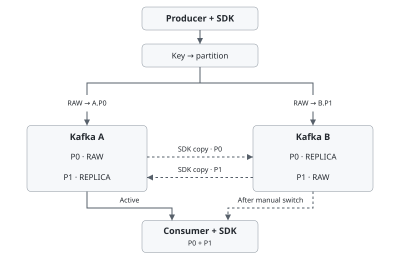

# kafka-active-active

[](https://github.com/keemgdeok/kafka-active-active/actions/workflows/ci.yml) [](https://adoptium.net/temurin/releases/?version=21)

[English](README.md) | [한국어](README.ko.md)

독립 Kafka 두 대를 연결하는 Java 21 SDK. key에 따라 발행을 나누고 상대편의 같은 파티션에 복제한다. 완료 이력으로 재전달을 차단한다.

[빠른 실행](#빠른-실행) · [동작 구조](#동작-구조) · [Java 사용법](#java-사용법) · [전달 보장](#전달-보장)

## 빠른 실행

JDK 21, Docker Compose v2, Bash, Python 3 필요. 로컬 포트는 `19092`, `29092`를 사용한다.

```bash
git clone https://github.com/keemgdeok/kafka-active-active.git
cd kafka-active-active
scripts/demo.sh 12 0
```

A가 멈춘 동안 B에서 발행과 소비를 이어간다. A가 돌아오면 데이터와 완료 이력을 복구하고 소비 그룹을 A로 옮긴다. 종료 시 데모 컨테이너와 볼륨을 삭제한다.

`build/reports/demo/events.jsonl`에서 양쪽 `audit` 항목은 `unique_events=12`, `missing=0`이어야 한다. `success` 항목은 `completed_redeliveries=0`이어야 한다.

## 동작 구조



담당 Kafka에 쓰지 못하거나 ACK 기한이 지나면 상대 Kafka의 같은 파티션에 한 번 쓰기를 시도한다. 각 소비 그룹은 한 번에 Kafka 한 곳에서 두 파티션을 읽는다.

## Java 사용법

Gradle 빌드에 SDK 소스를 연결한다. 경로는 저장소를 내려받은 위치에 맞춘다.

- `settings.gradle.kts` — `includeBuild("../kafka-active-active")`
- `build.gradle.kts` — `dependencies { implementation("io.github.keemgdeok:kafka-active-active") }`

`a`, `b`는 Kafka별 접속 설정이고 `topic`은 양쪽에서 사용하는 토픽 이름이다.

```java
// Reuse the publisher until shutdown.
var publisher = RoutedKafkaPublisher.open(PublishConfig.defaults(topic), a, b);

// For each event.
var resultStage = publisher.send(new Event(eventId, key, payloadBytes));
```

직렬화한 payload를 `byte[]`로 전달한다. 비동기 [발행 결과](#전달-보장)를 처리하고 앱 종료 시 Publisher를 닫는다. 토픽과 Kafka 쌍마다 `ReplicationService` 하나를 실행한다.

| 입력 | 조건 |
|---|---|
| 접속 설정 | A/B별 `bootstrap.servers` 맵과 인증 설정 |
| 이벤트 토픽 | 양쪽에 같은 이름으로 만든 새 SDK 전용 토픽, 파티션 2개, 복제 계수 1, offset 0부터 이력 보존 |
| 보존 설정 | `cleanup.policy=delete`, `retention.ms=-1`, `retention.bytes=-1` |

SDK 헤더가 없는 레코드가 있으면 그 레코드를 읽는 쪽의 복제가 멈출 수 있다. 이벤트·내부 토픽, 소비 그룹 offset, transactional ID에 접근할 권한이 필요하다. [Compose 설정](infra/compose.yaml)

### 발행 예제

Kafka 두 대를 시작하고 양쪽에 `events`를 만든다.

```bash
docker compose -f infra/compose.yaml up -d --wait kafka-a kafka-b
docker compose -f infra/compose.yaml run --rm init-topics
```

두 명령을 각각 다른 터미널에서 실행한다.

```bash
# Terminal 1: publisher and replication owner
KAA_REPLICATION_ENABLED=true ./gradlew --no-daemon runProducerExample

# Terminal 2: publisher only (the default role)
KAA_REPLICATION_ENABLED=false ./gradlew --no-daemon runProducerExample
```

한 터미널에 탭으로 구분된 이벤트를 입력한다. 새 이벤트마다 고유 ID를 쓴다.

```text
order-002	customer-42	hello
```

`replication=true`는 설정된 역할이다. 양방향 상태는 `ReplicationService.status()`로 확인한다. Ctrl+D로 입력을 끝내고 기존 담당 프로세스가 종료된 뒤 교체한다. [발행 예제](src/main/java/io/github/keemgdeok/kafkaactiveactive/demo/ProducerExample.java)

<details>
<summary>발행·복제·소비 Java 예제</summary>

저장소와 나란히 `sdk-example`을 만들고 `sdk-example/settings.gradle.kts`를 작성한다.

```kotlin
rootProject.name = "sdk-example"
includeBuild("../kafka-active-active")
```

`sdk-example/build.gradle.kts`를 작성한다.

```kotlin
plugins { application }
repositories { mavenCentral() }
java { toolchain.languageVersion.set(JavaLanguageVersion.of(21)) }
dependencies { implementation("io.github.keemgdeok:kafka-active-active") }
application { mainClass.set("Example") }
```

발행 예제 두 개를 종료한 뒤 실행한다. 코드는 `sdk-example/src/main/java/Example.java`에 저장한다.

```java
import io.github.keemgdeok.kafkaactiveactive.consume.ActiveKafkaConsumer;
import io.github.keemgdeok.kafkaactiveactive.consume.CommitResult;
import io.github.keemgdeok.kafkaactiveactive.consume.ConsumerSettings;
import io.github.keemgdeok.kafkaactiveactive.publish.Event;
import io.github.keemgdeok.kafkaactiveactive.publish.PublishConfig;
import io.github.keemgdeok.kafkaactiveactive.publish.RoutedKafkaPublisher;
import io.github.keemgdeok.kafkaactiveactive.replication.ReplicationConfig;
import io.github.keemgdeok.kafkaactiveactive.replication.ReplicationService;
import java.nio.charset.StandardCharsets;
import java.time.Duration;
import java.util.Map;

public class Example {
    public static void main(String[] args) {
        var a = Map.<String, Object>of("bootstrap.servers", "localhost:19092");
        var b = Map.<String, Object>of("bootstrap.servers", "localhost:29092");
        String topic = "events";
        var settings = ConsumerSettings.defaults(topic, "example-group");
        var event = new Event("order-001", "customer-42",
                "hello".getBytes(StandardCharsets.UTF_8));

        try (var replication = new ReplicationService(ReplicationConfig.defaults(topic), a, b);
             var publisher = RoutedKafkaPublisher.open(PublishConfig.defaults(topic), a, b);
             var consumer = new ActiveKafkaConsumer(settings, a, b)) {
            replication.start();
            var published = publisher.send(event).toCompletableFuture().join();
            System.out.println(published.status());
            if (!published.successful()) {
                throw new IllegalStateException("Publish " + published.status() + ": " + published.reason());
            }

            long deadline = System.nanoTime() + Duration.ofSeconds(10).toNanos();
            while (System.nanoTime() < deadline) {
                var batch = consumer.poll(Duration.ofMillis(250));
                if (batch.isEmpty()) continue;
                for (var delivery : batch.records()) {
                    System.out.println(delivery.event().eventId());
                }
                var committed = consumer.commit(batch.processed()).toCompletableFuture().join();
                System.out.println(committed.status());
                if (committed.status() == CommitResult.Status.UNKNOWN) {
                    throw new IllegalStateException("Close and reopen the consumer to replay completion history");
                }
            }
        }
    }
}
```

저장소 루트에서 실행한다.

```bash
./gradlew --no-daemon -p ../sdk-example run
```

새 토픽의 첫 실행에서 `order-001`이 출력된다. 다시 실행하면 완료된 ID가 걸러진다. Consumer의 생성·poll·commit·close는 같은 스레드에서 수행한다.

</details>

예제가 종료되면 Kafka를 내린다. 볼륨은 유지한다.

```bash
docker compose -f infra/compose.yaml down
```

## 전달 보장

| 발행 결과 | 반환 시점의 근거 |
|---|---|
| `CONFIRMED` | 양쪽 Kafka의 저장 ACK |
| `ACCEPTED_DEGRADED` | 한쪽 저장 ACK. 복제 전에 유일한 사본을 잃으면 이벤트가 유실될 수 있음 |
| `UNKNOWN` | 저장 미확정. 이벤트가 이미 기록됐을 수 있음 |
| `REJECTED` | 기록 시도 전 거절 |

`UNKNOWN`은 같은 ID·key·payload로 재시도한다. `REJECTED`는 원인을 해결한 뒤 재시도한다.

커밋은 파티션별로 수행한다. `CONFIRMED`는 새로 완료한 ID를 양쪽에서, `LOCAL_ONLY`는 활성 Kafka에서 확인한다. `UNKNOWN`이면 같은 Kafka에서 같은 그룹을 다시 연다. 완료 기록 전에 중단되면 처리가 반복될 수 있다. 장애·복구 중에는 중복 레코드와 동일 key의 순서 변경이 발생할 수 있다. [CommitResult](src/main/java/io/github/keemgdeok/kafkaactiveactive/consume/CommitResult.java)

## 복구와 소비 전환

`RepairService.runOnce()`는 캡처한 로그 범위의 누락 사본을 보충한다. [RepairService](src/main/java/io/github/keemgdeok/kafkaactiveactive/repair/RepairService.java)

수동 전환 시 기존 Consumer를 모두 종료하고 중지 상태를 유지한다. 양쪽 Kafka에 접근할 수 있을 때 `GroupTransition.prepare()`로 데이터와 완료 이력을 복구한 뒤 `startTarget()`을 호출한다. Offset은 각 Kafka에서 따로 관리한다. 전환 대상은 복구한 완료 이력으로 이미 처리한 이벤트를 건너뛴다. [전환 예제](src/main/java/io/github/keemgdeok/kafkaactiveactive/demo/DemoMain.java)

[발행 설정](src/main/java/io/github/keemgdeok/kafkaactiveactive/publish/PublishConfig.java) · [소비 설정](src/main/java/io/github/keemgdeok/kafkaactiveactive/consume/ConsumerSettings.java) · [CI](.github/workflows/ci.yml) · [빌드 작업](build.gradle.kts)

[이슈](https://github.com/keemgdeok/kafka-active-active/issues) · [기여 가이드](CONTRIBUTING.md) · [Apache-2.0](LICENSE)
