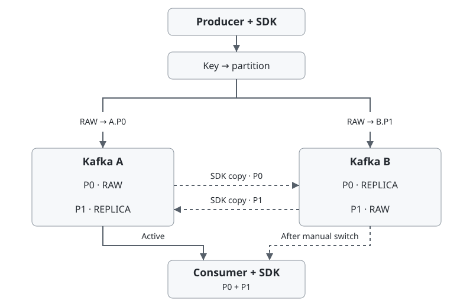

# kafka-active-active

[](https://github.com/keemgdeok/kafka-active-active/actions/workflows/ci.yml) [](https://adoptium.net/temurin/releases/?version=21)

[English](README.md) | [한국어](README.ko.md)

Java 21 SDK for two independent Kafka deployments. Routes writes by key, replicates records to the same partition on the peer, and filters completed events.

[Quick start](#quick-start) · [How it works](#how-it-works) · [Java usage](#java-usage) · [Delivery guarantees](#delivery-guarantees)

## Quick start

JDK 21, Docker Compose v2, Bash, Python 3. Local ports `19092` and `29092`.

```bash
git clone https://github.com/keemgdeok/kafka-active-active.git
cd kafka-active-active
scripts/demo.sh 12 0
```

The demo stops A while B handles writes and reads. After A recovers, the demo repairs data and completion history, switches the group to A, and removes its containers and volumes on exit.

In `build/reports/demo/events.jsonl`, both `audit` entries should show `unique_events=12` and `missing=0`. The `success` entry should show `completed_redeliveries=0`.

## How it works



If the preferred write fails or its ACK deadline expires, the SDK attempts one write to the same partition on the other Kafka. Each consumer group reads both partitions on one Kafka at a time.

## Java usage

Add the SDK source to your Gradle build. Adjust the checkout path as needed.

- `settings.gradle.kts` — `includeBuild("../kafka-active-active")`
- `build.gradle.kts` — `dependencies { implementation("io.github.keemgdeok:kafka-active-active") }`

`a` and `b` hold the Kafka connection settings. `topic` is the shared topic name.

```java
// Reuse the publisher until shutdown.
var publisher = RoutedKafkaPublisher.open(PublishConfig.defaults(topic), a, b);

// For each event.
var resultStage = publisher.send(new Event(eventId, key, payloadBytes));
```

Pass the serialized payload as `byte[]`, handle the [publish result](#delivery-guarantees), and close the publisher at shutdown. Run one `ReplicationService` per topic and Kafka pair.

| Input | Requirement |
|---|---|
| Connections | Separate `bootstrap.servers` maps and authentication settings for A and B |
| Event topic | New SDK-only topic with the same name on both sides, 2 partitions, replication factor 1, history retained from offset 0 |
| Retention | `cleanup.policy=delete`, `retention.ms=-1`, `retention.bytes=-1` |

A record without SDK headers can stop replication from its source broker. The SDK requires access to event and internal topics, group offsets, and transactional IDs. [Compose configuration](infra/compose.yaml)

### Producer example

Start both brokers and create `events` on each.

```bash
docker compose -f infra/compose.yaml up -d --wait kafka-a kafka-b
docker compose -f infra/compose.yaml run --rm init-topics
```

Run the two commands in separate terminals.

```bash
# Terminal 1: publisher and replication owner
KAA_REPLICATION_ENABLED=true ./gradlew --no-daemon runProducerExample

# Terminal 2: publisher only (the default role)
KAA_REPLICATION_ENABLED=false ./gradlew --no-daemon runProducerExample
```

Paste a tab-separated event into either terminal. Use a distinct ID for each new event.

```text
order-002	customer-42	hello
```

`replication=true` shows the configured role. `ReplicationService.status()` reports both directions. End input with Ctrl+D and wait for the owner to exit before starting its replacement. [Producer example](src/main/java/io/github/keemgdeok/kafkaactiveactive/demo/ProducerExample.java)

<details>
<summary>Java example with publishing, replication, and consumption</summary>

Create `sdk-example` alongside this repository. Add `sdk-example/settings.gradle.kts`.

```kotlin
rootProject.name = "sdk-example"
includeBuild("../kafka-active-active")
```

Add `sdk-example/build.gradle.kts`.

```kotlin
plugins { application }
repositories { mavenCentral() }
java { toolchain.languageVersion.set(JavaLanguageVersion.of(21)) }
dependencies { implementation("io.github.keemgdeok:kafka-active-active") }
application { mainClass.set("Example") }
```

End both producer examples before starting this example. Save it as `sdk-example/src/main/java/Example.java`.

```java
import io.github.keemgdeok.kafkaactiveactive.consume.ActiveKafkaConsumer;
import io.github.keemgdeok.kafkaactiveactive.consume.CommitResult;
import io.github.keemgdeok.kafkaactiveactive.consume.ConsumerSettings;
import io.github.keemgdeok.kafkaactiveactive.publish.Event;
import io.github.keemgdeok.kafkaactiveactive.publish.PublishConfig;
import io.github.keemgdeok.kafkaactiveactive.publish.RoutedKafkaPublisher;
import io.github.keemgdeok.kafkaactiveactive.replication.ReplicationConfig;
import io.github.keemgdeok.kafkaactiveactive.replication.ReplicationService;
import java.nio.charset.StandardCharsets;
import java.time.Duration;
import java.util.Map;

public class Example {
    public static void main(String[] args) {
        var a = Map.<String, Object>of("bootstrap.servers", "localhost:19092");
        var b = Map.<String, Object>of("bootstrap.servers", "localhost:29092");
        String topic = "events";
        var settings = ConsumerSettings.defaults(topic, "example-group");
        var event = new Event("order-001", "customer-42",
                "hello".getBytes(StandardCharsets.UTF_8));

        try (var replication = new ReplicationService(ReplicationConfig.defaults(topic), a, b);
             var publisher = RoutedKafkaPublisher.open(PublishConfig.defaults(topic), a, b);
             var consumer = new ActiveKafkaConsumer(settings, a, b)) {
            replication.start();
            var published = publisher.send(event).toCompletableFuture().join();
            System.out.println(published.status());
            if (!published.successful()) {
                throw new IllegalStateException("Publish " + published.status() + ": " + published.reason());
            }

            long deadline = System.nanoTime() + Duration.ofSeconds(10).toNanos();
            while (System.nanoTime() < deadline) {
                var batch = consumer.poll(Duration.ofMillis(250));
                if (batch.isEmpty()) continue;
                for (var delivery : batch.records()) {
                    System.out.println(delivery.event().eventId());
                }
                var committed = consumer.commit(batch.processed()).toCompletableFuture().join();
                System.out.println(committed.status());
                if (committed.status() == CommitResult.Status.UNKNOWN) {
                    throw new IllegalStateException("Close and reopen the consumer to replay completion history");
                }
            }
        }
    }
}
```

Run from the repository root.

```bash
./gradlew --no-daemon -p ../sdk-example run
```

On a fresh topic, the first run prints `order-001`. The next run filters that ID. Create, poll, commit, and close each consumer on the same thread.

</details>

After the examples exit, stop the brokers. The volumes are retained.

```bash
docker compose -f infra/compose.yaml down
```

## Delivery guarantees

| Publish result | Evidence at response time |
|---|---|
| `CONFIRMED` | Storage ACKs from both Kafka deployments |
| `ACCEPTED_DEGRADED` | One storage ACK. Losing the only copy before replication can lose the event |
| `UNKNOWN` | Storage unconfirmed. The event may already exist |
| `REJECTED` | Rejected before a write attempt |

Retry `UNKNOWN` with the same ID, key, and payload. Resolve the cause of `REJECTED` before retrying.

Consumer commits are per partition. `CONFIRMED` verifies newly completed IDs on both sides. `LOCAL_ONLY` verifies them on the active Kafka. On `UNKNOWN`, reopen the same group on the same Kafka. Processing can repeat before completion is recorded. Faults and recovery can cause duplicates and change order within a key. [CommitResult](src/main/java/io/github/keemgdeok/kafkaactiveactive/consume/CommitResult.java)

## Recovery and consumer switching

`RepairService.runOnce()` fills missing copies within a captured log boundary. [RepairService](src/main/java/io/github/keemgdeok/kafkaactiveactive/repair/RepairService.java)

For a manual switch, stop all source consumers and keep them stopped. With both Kafka deployments reachable, use `GroupTransition.prepare()` to recover data and completion history, then call `startTarget()`. Each Kafka keeps its own offsets. The target uses the recovered completion history to skip completed events. [Transition example](src/main/java/io/github/keemgdeok/kafkaactiveactive/demo/DemoMain.java)

[Publisher settings](src/main/java/io/github/keemgdeok/kafkaactiveactive/publish/PublishConfig.java) · [Consumer settings](src/main/java/io/github/keemgdeok/kafkaactiveactive/consume/ConsumerSettings.java) · [CI](.github/workflows/ci.yml) · [Build tasks](build.gradle.kts)

[Issues](https://github.com/keemgdeok/kafka-active-active/issues) · [Contributing](CONTRIBUTING.md) · [Apache-2.0](LICENSE)
